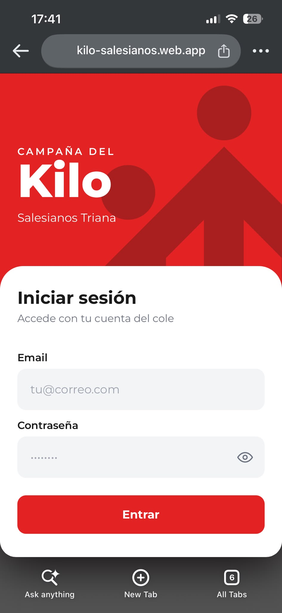
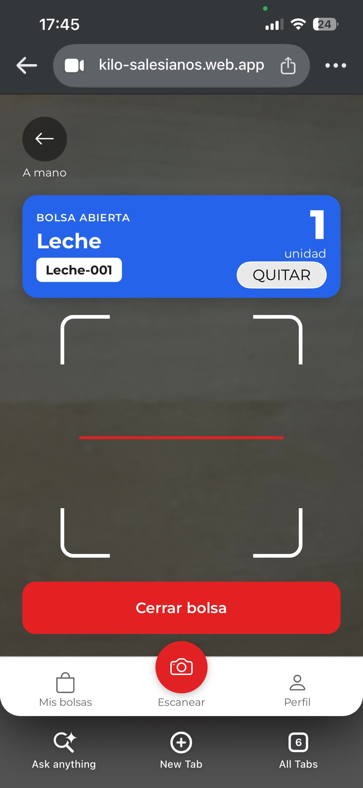
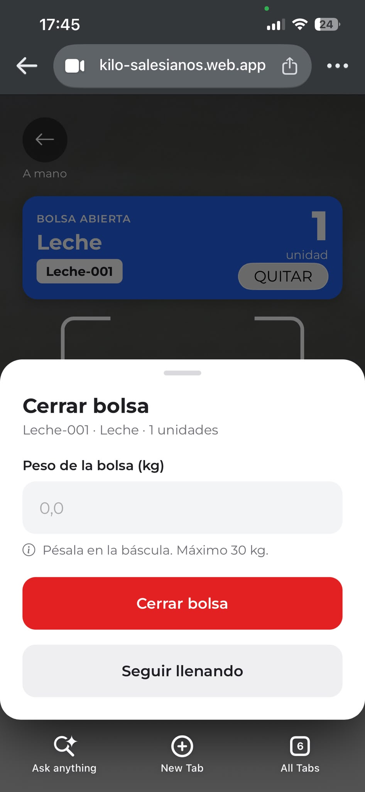
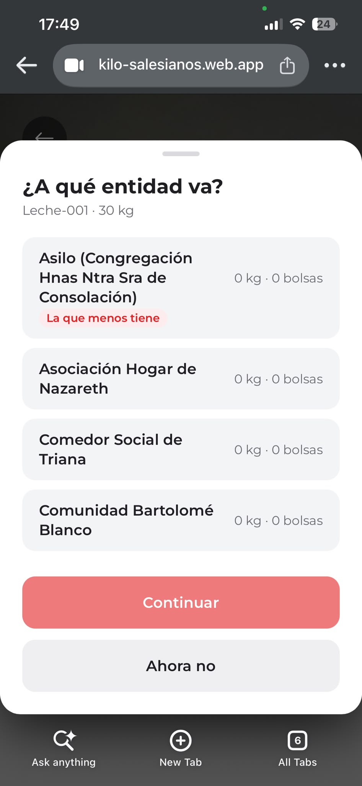
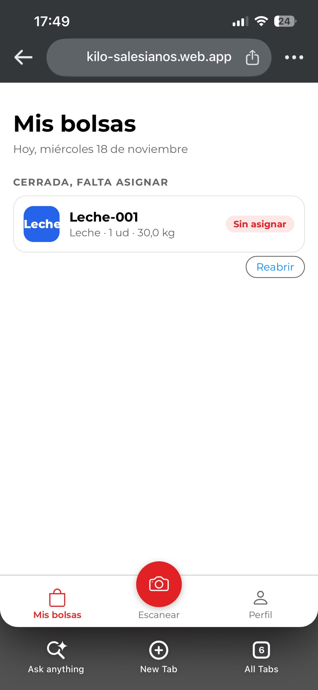
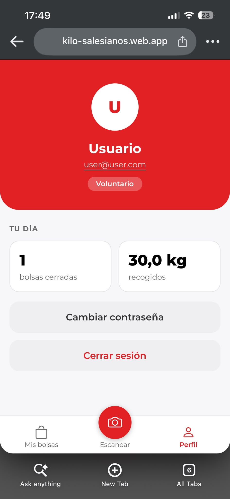
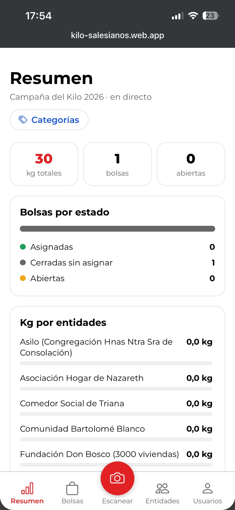
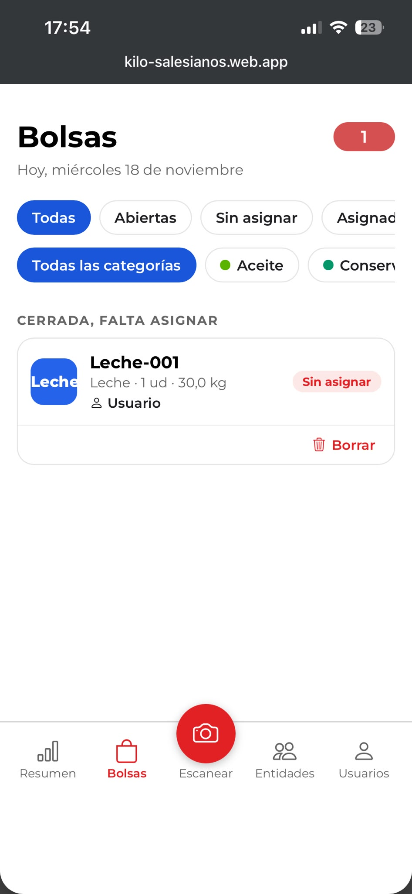
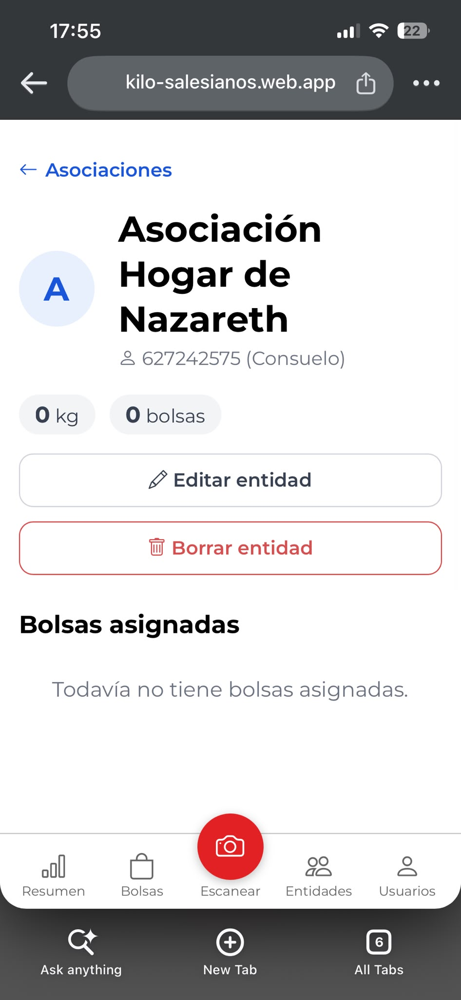
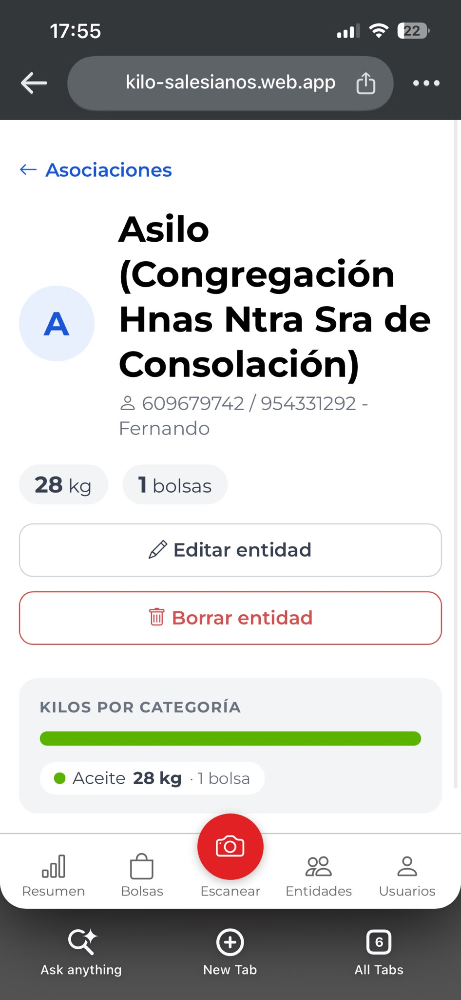

# Campaña del Kilo · Salesianos de Triana

Aplicación web _mobile-first_ para dar trazabilidad a la **Campaña del Kilo**. Los voluntarios abren una bolsa con una categoría, escanean el QR de categoría pegado en cada alimento antes de meterlo, la cierran con su peso y la asignan a una entidad (asociación) de destino. El coordinador gestiona categorías y entidades, revisa todas las bolsas y ve los kilos recogidos.

> Proyecto de 2.º de DAM · Salesianos de Triana (Sevilla) · Equipo de 2 personas.

---

## Índice

- [Funcionalidades](#funcionalidades)
- [Stack tecnológico](#stack-tecnológico)
- [Requisitos previos](#requisitos-previos)
- [Instalación y ejecución en local](#instalación-y-ejecución-en-local)
- [Configuración de Firebase](#configuración-de-firebase)
- [Scripts disponibles](#scripts-disponibles)
- [Despliegue](#despliegue)
- [Estructura del proyecto](#estructura-del-proyecto)
- [Modelo de datos](#modelo-de-datos)
- [Flujo de trabajo con Git](#flujo-de-trabajo-con-git)
- [Autores](#autores)
- [Licencia](#licencia)

---

## Funcionalidades

### Voluntario

- **Inicio de sesión** con email y contraseña (Firebase Authentication) y rol asociado.
- **Escáner QR** con la cámara trasera del móvil (solo códigos QR). Cada QR contiene el identificador de una categoría.
- **Abrir una bolsa** escaneando el primer QR, que fija su categoría.
- **Llenar la bolsa**: cada escaneo de la misma categoría suma una unidad. Si el alimento es de otra categoría, la app lo rechaza con un aviso visual; si el QR no es válido, avisa.
- **Introducir un alimento a mano** cuando la cámara falla (ruta `/a-mano`).
- **Quitar una unidad** de la bolsa abierta; si llega a 0 unidades, se puede eliminar la bolsa.
- **Cerrar la bolsa** introduciendo su peso en kg (con validación de peso máximo de 30 kg y bolsa no vacía).
- **Asignar la bolsa** a una entidad existente o crear una nueva en el momento.
- **Mis bolsas**: listado agrupado por estado (abiertas, cerradas, asignadas) con acciones para reabrir, quitar la entidad o cambiarla.
- **Perfil**: ver los datos propios y cerrar sesión.

### Coordinador (administrador)

Todo lo del voluntario, y además:

- **Resumen**: panel con los datos generales de la campaña.
- **Categorías**: crear, editar (nombre y color) y borrar categorías.
- **Entidades**: crear, editar y borrar entidades; ver el detalle de cada una con sus bolsas asignadas y sus **kilos por categoría**.
- **Listado de todas las bolsas** con su creador y filtros por estado y categoría.
- **Borrar bolsas** de cualquier usuario (los kilos y el número de bolsas de la entidad se actualizan).
- Los datos que apuntan a algo borrado (una categoría, un usuario o una entidad) se muestran como **"Eliminado"**.

### Seguridad

- Rutas protegidas con _guards_ (`authGuard`, `guestGuard`, `roleGuard`, `adminGuard`).
- Reglas de seguridad de Firestore por rol en `firestore.rules`.

---

## Capturas

### Voluntario

|       Inicio de sesión        |            Escáner y bolsa abierta            |             Cerrar bolsa             |
| :---------------------------: | :-------------------------------------------: | :----------------------------------: |
| < | < | < |

|              Asignar entidad              |             Mis bolsas             |             Perfil             |
| :---------------------------------------: | :--------------------------------: | :----------------------------: |
| < | < | < |

### Coordinador

|             Resumen             |           Todas las bolsas           |
| :-----------------------------: | :----------------------------------: |
| < | < |

|            Entidades            |             Detalle de entidad             |            Kilos por categoría            |
| :-----------------------------: | :----------------------------------------: | :---------------------------------------: |
| <[alt text](docs/entidades.png) |  |  |

---

## Stack tecnológico

| Parte                    | Tecnología                                                                         |
| ------------------------ | ---------------------------------------------------------------------------------- |
| Framework                | [Angular](https://angular.dev) 22 (componentes _standalone_, señales)              |
| Lenguaje                 | TypeScript 6                                                                       |
| Backend                  | [Firebase](https://firebase.google.com): Authentication, Cloud Firestore y Hosting |
| Integración con Firebase | [@angular/fire](https://github.com/angular/angularfire)                            |
| Lectura de QR            | [ngx-scanner-qrcode](https://www.npmjs.com/package/ngx-scanner-qrcode)             |
| Iconos                   | [Bootstrap Icons](https://icons.getbootstrap.com)                                  |
| Estilos                  | SCSS                                                                               |

Las versiones exactas están en [`package.json`](package.json).

---

## Requisitos previos

- [Node.js](https://nodejs.org) en una versión compatible con Angular 22 (consulta la [tabla de compatibilidad](https://angular.dev/reference/versions)).
- npm (el proyecto declara `npm@11.19.0` en `packageManager`).
- [Angular CLI](https://angular.dev/tools/cli): `npm install -g @angular/cli`
- [Firebase CLI](https://firebase.google.com/docs/cli) para desplegar: `npm install -g firebase-tools`

> El escáner usa la cámara del navegador, que solo funciona en `localhost` o con **HTTPS**. Firebase Hosting ya sirve la app por HTTPS.

---

## Instalación y ejecución en local

```bash
# 1. Clonar el repositorio
git clone https://github.com/francisco-aguilar04/Kilo-salesianos.git
cd Kilo-salesianos

# 2. Instalar dependencias
npm install

# 3. Arrancar el servidor de desarrollo
ng serve
```

Abre `http://localhost:4200/` en el navegador. La app se recarga sola al guardar cambios.

---

## Configuración de Firebase

La configuración del proyecto de Firebase está en:

```
src/environments/environment.ts              # producción (ng build)
src/environments/environment.development.ts  # desarrollo (ng serve)
```

Ambos archivos exportan un objeto `environment.firebase` con estos campos:

```ts
export const environment = {
  firebase: {
    apiKey: '...',
    authDomain: '...',
    projectId: '...',
    storageBucket: '...',
    messagingSenderId: '...',
    appId: '...',
  },
};
```

Si quieres usar tu propio proyecto de Firebase:

1. Crea un proyecto en la [consola de Firebase](https://console.firebase.google.com).
2. Activa **Authentication** con el proveedor _Email/Password_ y crea una base de datos **Cloud Firestore**.
3. Registra una app web y copia su configuración en los dos archivos de `environments`.
4. Cambia el proyecto por defecto en `.firebaserc` (o usa `firebase use <id-del-proyecto>`).
5. Despliega las reglas de seguridad: `firebase deploy --only firestore:rules`.
6. Crea en Firestore las categorías y los usuarios (colección `usuarios`, campo `rol` con valor `voluntario` o `coordinador`).

---

## Scripts disponibles

| Comando                      | Qué hace                                                   |
| ---------------------------- | ---------------------------------------------------------- |
| `npm start` / `ng serve`     | Servidor de desarrollo en `http://localhost:4200/`         |
| `npm run build` / `ng build` | Compila para producción en `dist/campana-del-kilo/browser` |
| `npm run watch`              | Compila en modo desarrollo y recompila al guardar          |
| `npm test` / `ng test`       | Ejecuta los tests unitarios con Vitest                     |

---

## Despliegue

La app se publica en **Firebase Hosting**. La configuración está en `firebase.json`: sirve la carpeta `dist/campana-del-kilo/browser` y redirige todas las rutas a `index.html` para que funcione el enrutado de Angular.

```bash
# 1. Iniciar sesión en Firebase (solo la primera vez)
firebase login

# 2. Compilar para producción
ng build

# 3. Desplegar Hosting y reglas de Firestore
firebase deploy

# o solo una parte
firebase deploy --only hosting
firebase deploy --only firestore:rules
```

---

## Estructura del proyecto

```
Kilo-salesianos/
├── public/                     # Recursos estáticos (favicon, logo)
├── src/
│   ├── app/
│   │   ├── core/               # Lógica común de la app
│   │   │   ├── constants/      # Roles, estados de bolsa, peso máximo
│   │   │   ├── errors/         # Errores propios (p. ej. QR no válido)
│   │   │   ├── guards/         # authGuard, guestGuard, roleGuard, adminGuard
│   │   │   ├── interfaces/     # Modelos: Caja, Categoria, Asociacion, Usuario
│   │   │   ├── services/       # Acceso a Firebase (auth, cajas, categorías, entidades, resumen…)
│   │   │   └── utils/
│   │   ├── features/           # Pantallas (una carpeta por funcionalidad)
│   │   │   ├── auth/login/
│   │   │   ├── inicio/         # Cámara + bolsa abierta
│   │   │   ├── introducir-a-mano/
│   │   │   ├── hoja-nueva-caja/ · hoja-cerrar-caja/ · hoja-asignar-caja/
│   │   │   ├── cajas/          # Mis bolsas / todas las bolsas (coordinador)
│   │   │   ├── asociaciones/   # Entidades y su detalle
│   │   │   ├── categorias/
│   │   │   ├── panel/          # Resumen del coordinador
│   │   │   └── perfil/
│   │   ├── shared/             # Piezas reutilizables
│   │   │   ├── components/     # escaner, navbar, barra-caja, tarjeta-caja, modales, aviso…
│   │   │   └── pipes/          # Pipe "eliminado"
│   │   ├── app.config.ts       # Proveedores (Firebase, router…)
│   │   └── app.routes.ts       # Rutas y guards
│   ├── environments/           # Configuración de Firebase
│   └── styles.scss             # Estilos globales
├── firebase.json               # Configuración de Hosting y Firestore
├── firestore.rules             # Reglas de seguridad de Firestore
└── package.json
```

> En el código y en Firestore la entidad se sigue llamando `caja` / `cajas` (`CajasService`, colección `cajas`); en la interfaz se muestra como **bolsa**. Del mismo modo, las entidades se guardan en la colección `asociaciones`.

---

## Modelo de datos

| Colección      | Uso                                                                  |
| -------------- | -------------------------------------------------------------------- |
| `usuarios`     | Datos del usuario y su rol (`voluntario` o `coordinador`)            |
| `categorias`   | `nombre`, `codigoQr`, `color`, `activa`                              |
| `asociaciones` | Entidades de destino, con los kg recibidos y el número de bolsas     |
| `cajas`        | Bolsas: categoría, unidades, peso, estado, creador, entidad y fechas |
| `contadores`   | Contadores auxiliares                                                |

Estados de una bolsa: `abierta` → `cerrada` → `asignada`.

---

## Flujo de trabajo con Git

Usamos tres niveles de ramas:

| Rama          | Para qué                                                                    |
| ------------- | --------------------------------------------------------------------------- |
| `main`        | Versión estable y desplegada                                                |
| `develop`     | Integración de las funcionalidades terminadas                               |
| `feature/...` | Una rama por tarea o historia de usuario (p. ej. `feature/A2-QuitarUnidad`) |

1. Crear la rama de la tarea desde `develop`.
2. Hacer commits pequeños y descriptivos (`feat: ...`, `fix(...): ...`, `style: ...`).
3. Abrir un **Pull Request** hacia `develop` y revisarlo entre los dos.
4. Cuando `develop` está estable, PR de `develop` a `main`.
5. Cada versión publicada en `main` se marca con una **etiqueta semver** (`vMAJOR.MINOR.PATCH`). La primera es **`v1.0.0`**.

```bash
git tag -a v1.0.0 -m "Versión 1.0.0"
git push origin v1.0.0
```

---

## Autores

| Nombre               | GitHub                                             |
| -------------------- | -------------------------------------------------- |
| `Díaz Stoica, David` | [@usuario](https://github.com/davidiazstoica05-ux) |
| `Aguilar Cid, Paco`  | [@usuario](https://github.com/francisco-aguilar04) |

Proyecto realizado en 2.º de Desarrollo de Aplicaciones Multiplataforma (DAM) en Salesianos de Triana, Sevilla.

---

## Licencia

Este proyecto se distribuye bajo la licencia MIT. Consulta el archivo [`LICENSE`](LICENSE) para más detalles.
